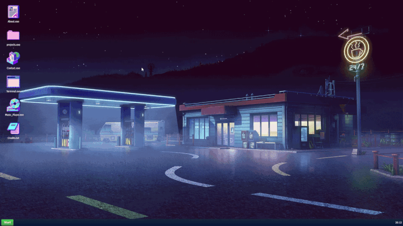

# Hi, I'm Niamh! 🌱

I'm a Software Engineering student with a particular interest in **Python, backend development, databases and algorithms**.

I've been experimenting with programming since I was young, from HTML and e-commerce development to building games, APIs and developer tools.

I enjoy learning by building things, solving problems and figuring out how software works behind the scenes.

### 🛠️ Tech I Work With

**Languages:** Python, SQL, C++, JavaScript, TypeScript

**Backend:** FastAPI, Flask, Django, REST APIs, SQLite

**Tools:** Git, Linux, Docker, VS Code

### 🚀 Featured Projects

**[Tabletop Game Management System](https://github.com/nievyx/databases-assignment)**

A full-stack tabletop game management application using Python, FastAPI, raw SQL, React and Docker Compose. Features a relational database and REST API for managing game data.

**[Niamh's Monster Cards](https://github.com/nievyx/card_pygame)**

A turn-based card battle game built with Python and Pygame, featuring AI opponents, spells, wave-based battles and resource management.

**[Tic-Tac-Toe Minimax AI](https://github.com/nievyx/tictactoe-minimax-ai)**

A C++ implementation of Tic-Tac-Toe featuring an unbeatable opponent powered by recursive Minimax game-tree evaluation.

**[Terminal RPG](https://github.com/nievyx/class-based-rpg-python)**

A Python terminal RPG featuring turn-based combat, maps, character classes and inventory systems.

<!--  -->

### 🖥️ Explore Niamh World

**[🌍 Visit Niamh World](https://www.niamh.world)**

My interactive, retro desktop-inspired portfolio, built with React. Explore projects through a playful window-based interface.

  

### 🔗 Find Me

- 🌐 [Niamh World](https://www.niamh.world)
- 💻 [Software Portfolio](https://niamhdev.com/)
- 🐙 [GitHub Projects](https://github.com/nievyx)
<!--
**nievyx/nievyx** is a ✨ _special_ ✨ repository because its `README.md` (this file) appears on your GitHub profile.

Here are some ideas to get you started:

- 🔭 I’m currently working on ...
- 🌱 I’m currently learning ...
- 👯 I’m looking to collaborate on ...
- 🤔 I’m looking for help with ...
- 💬 Ask me about ...
- 📫 How to reach me: ...
- 😄 Pronouns: ...
- ⚡ Fun fact: ...
-->
